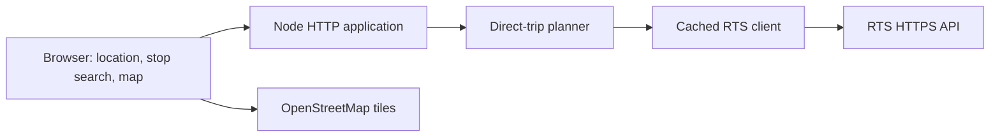

# Architecture

LeaveNow is a small Node.js service with a static browser interface. No application code from the historical Streamlit prototype is executed. The active planner uses provider predictions, not an AI-generated or locally trained travel-time model.

## Modules

| Module                  | Responsibility                                                                       |
| ----------------------- | ------------------------------------------------------------------------------------ |
| `src/server/index.js`   | Read local environment, validate config, create listener, shut down gracefully       |
| `src/server/config.js`  | Validate API key and port                                                            |
| `src/server/app.js`     | HTTP routes, input/origin/host validation, static asset serving                      |
| `src/server/transit.js` | HTTPS RTS requests, timeouts, normalization, cache and concurrent-request coalescing |
| `src/server/planner.js` | Distance, walking estimates, Rochester timestamps, fresh prediction matching         |
| `public/app.js`         | Form state, permission handling, stop selection, map layers, results and refreshing  |

## Planning sequence

1. Validate numeric origin/destination coordinates and walking allowance (5, 10, 15, or 20 minutes).
2. Obtain normalized RTS stops. Calculate great-circle distances from each location.
3. Find up to six stops within the walking allowance at each end. Convert the allowance to a distance using the same walking estimate as the result cards.
4. Fetch predictions for the unique stops, with no more than three requests in flight for one plan.
5. Reject feeds more than three minutes old, timestamps more than one minute in the future, malformed ETA values, and departures that cannot be reached with walking plus the boarding buffer.
6. Match route and external trip ID (falling back to RTS TripId), require agreement on vehicle ID when supplied at both ends, require the same feed date, and require the destination ETA to be later than departure and within three hours.
7. Prefer the closest usable boarding stop, then its earliest catchable departure, then arrival at the final destination. Deduplicate a trip at a boarding stop and return up to eight choices.
8. Display the closest physical stop separately. Any unverified nearby departures are explicitly marked as not verified to reach the destination.

All agency timestamps are interpreted in `America/New_York`, independently of the computer’s timezone. Unknown/missing trip identity is not enough to recommend a bus.

## Data and privacy

The RTS credential is loaded from server environment variables or the ignored root `.env`. It is only sent to the provider over HTTPS. Only stop IDs are sent to RTS for planning; the user’s coordinates stay between their browser and this local server.

No location or trip database exists. The server does not log request bodies or coordinates. Map tile requests go directly to OpenStreetMap, revealing the viewed map area to that service. Clicking the optional Google walking-directions link shares the selected endpoints with Google.

## Caching and failures

RTS stops are cached for one hour, predictions for 15 seconds, and vehicles for 20 seconds. Simultaneous identical upstream requests share a promise. The cache is process-local and bounded by entry count. Every upstream request has a ten-second timeout. The app does not substitute fabricated or scheduled predictions on failure.

A plan can return partial coverage with a warning when some stops fail. If all prediction requests fail, the server returns an error rather than claiming there is no bus. Fresh positions are the only vehicles shown on the map.

## Deliberate boundaries

Search covers RTS stop names and IDs. Map pins and coordinate entry support arbitrary starting/destination locations without introducing an external address-geocoding dependency. No transfers, GTFS schedule search, road-network walking routing, or inferred bus geometry are implemented. Future transfer planning should use an ordered timetable/GTFS graph rather than combining unrelated arrival predictions.

## Timetable extension

The live Streamlit deployment now uses `schedule.js` for service calendars, trip/stop order, and bounded direct/one-transfer search. `journeys.js` validates travel controls, joins fresh RTS predictions by exact GTFS trip ID, and rechecks catchability, arrival deadlines, and transfer buffers after live changes. `scripts/import-gtfs.py` builds the compact artifact from the official feed. See [timetable routing](timetable-routing.md) for the current flow; the earlier direct-only sequence above describes the compatibility fallback and original browser interface.
