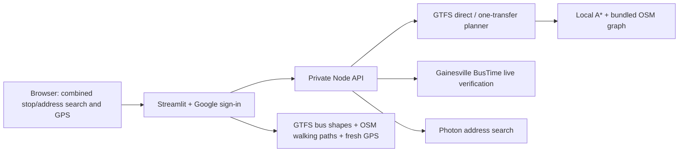

# Architecture

The public Gainesville app is Streamlit with Google sign-in, backed by a private Node API in the same Docker container on Render. `deploy/public_entrypoint.py` starts both processes, imports the official GTFS feed, and probes readiness. The original static browser interface is retained for compatibility. No trained travel-time model is used.

## Modules and planning

- `schedule.js`: service calendars, ordered stops, direct/one-transfer candidates, routed access/egress/transfer walks, and ranking.
- `walking.js`: segment snapping, bounded local A*, compact typed arrays, and bounded caches. `scripts/import-walking.py` compiles the pinned ODbL graph.
- `journeys.js`: travel controls, exact-trip live overlays, and updated catchability/deadline checks.
- `bustime.js`: Gainesville live predictions, patterns and GPS; live bus choices require verified downstream stop order.
- `geocoding.js` and stop APIs: combined UI suggestions using local stop matches and debounced external address lookup.
- `prototypes/streamlit/app.py` and `presentation.py`: compact search, trip controls, account menu, bus selection, map and timeline.

Stops are shortlisted by proximity, then walking paths determine feasible access and egress. The planner considers up to 40 nearby graph candidates at each end and retains up to 12 routed stops. Direct and one-transfer timetable trips are checked against walking time, the two-minute boarding allowance, transfer buffers, service dates, and user time controls. Up to three distinct first departures are ranked; dominated transfer variants are grouped. Live updates recheck feasibility. Bus paths are published GTFS shapes, not recorded vehicle trails. All agency times use `America/New_York`.

See [routing limits](timetable-routing.md), [OSM coverage and fallback policy](walking-routing.md), and [API fields](api.md). These bounded searches do not prove that every possible journey was considered.

## Data, privacy and resources

`GAINESVILLE_RTS_API_KEY` stays in server-side deployment secrets and is never embedded in browser assets. User coordinates are used for the trip request; address queries are sent to the configured geocoder. Browser/device permission is required for GPS. Basemap requests disclose the viewed area to the configured map provider.

Walking searches use the bundled snapshot without external routing requests, paid routing keys, or an additional service. Times are modelled at 65 m/min with mapped crossing/stair allowances; short endpoint links and uncovered locations remain labelled estimates. Known disconnected graph paths are excluded. The snapshot needs deliberate refresh and cannot reflect every closure or accessibility restriction.

Docker limits Node heap growth to leave room for Streamlit on the free instance. See [the measured rollout](walking-routing.md#deployment-verification--november-18-2026-eastern) for test counts, hosted memory, and limitations. Deployment wiring and operational checks are documented in [public deployment](public-deployment.md) and [operations](operations.md).
